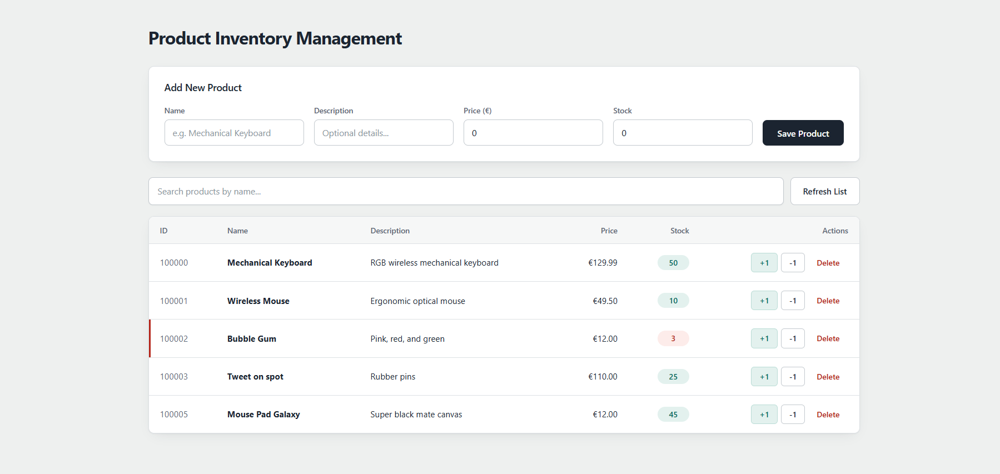

# ProductManagement

A responsive full-stack product management dashboard built with **Angular** (Standalone Components & Signals) and an **ASP.NET Core (.NET 10) Web API** backend, featuring full CRUD operations, live stock adjustments, error/empty-state handling, and a neutral grey enterprise UI with high-contrast red alerts for errors and low stock.

---

## Repository Structure

```text
ProductManagement/
├── Backend/        # ASP.NET Core (.NET 10) Web API, EF Core (Code-First), SQL Server LocalDB & Integration Tests
├── Frontend/       # Angular SPA (Standalone Components, Signals, HttpClient)
├── docs/images     # README image
└── README.md
```

---

## Tech Stack

### Backend (`/Backend`)

- **Framework:** ASP.NET Core Web API (.NET 10)
- **Data Access:** Entity Framework Core (Code-First)
- **Database:** SQL Server LocalDB
- **API Documentation:** Swagger / OpenAPI
- **Testing:** Automated Integration Tests

### Frontend (`/Frontend`)

- **Framework:** Angular (Standalone Components, `inject()` DI, `FormsModule` / `[(ngModel)]`)
- **State Management:** Angular Signals (`.set()` & `.update()`)
- **HTTP Client:** Angular `HttpClient`
- **Styling:** Custom CSS with a neutral grey palette, high-contrast red alerts/actions, and a responsive `1400px` Flexbox layout

### Development Environment

- **Node.js:** v26.13.1
- **npm:** 11.20.0
- **Visual Studio Code:** v1.146.0

---

## Key Features

- **Full CRUD Operations:** Create, read, update, and delete products seamlessly across frontend and backend.
- **Live Stock Management:** Increment (`+1`) and decrement (`-1`) stock quantities directly from the product table with automatic low-stock visual alerts.
- **Search & Filtering:** Quickly filter products by name.
- **Reactive Signal-Based UI:** Immediate immutable UI updates on product creation and explicit red error banners when the API is unreachable or returns no items.

---

## Getting Started

### Prerequisites

- [.NET 10 SDK](https://dotnet.microsoft.com/download)
- [Node.js](https://nodejs.org/) v26.13.1
- npm v11.20.0
- Angular CLI
- SQL Server LocalDB (included with Visual Studio)
- Visual Studio Code v1.146.0 (recommended)

---

### 1. Run the Backend API

Navigate to the `Backend` folder (where the `.csproj` file is located) and run:

```bash
cd Backend
dotnet ef database update
dotnet run
```

- Once running, Swagger UI is available at the local URL printed in the terminal (e.g., `https://localhost:<port>/swagger`).
- Make sure the API base URL configured in `Frontend` matches the port your backend is listening on.

---

### 2. Run the Frontend Application

In a separate terminal, navigate to the `Frontend` folder, install dependencies, and start the Angular development server:

```bash
cd Frontend
npm install
npm start
```

Open your browser at `http://localhost:4200/`.

---

## Running Backend Tests

From the `Backend` directory (or the test project directory), execute:

```bash
dotnet test
```

---

## Screenshot





---

